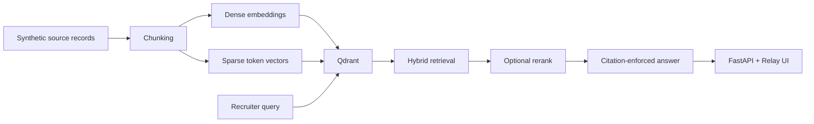

# Relay — cited enterprise search

**Recruiter links:** add your Render demo URL and public GitHub URL here after deployment.

> Public-demo safety: every record in this repository is synthetic. No real company documents, credentials, or personal data are included.

A company-scale retrieval-augmented answer system with a cited-answer UI. The architecture is designed around the project brief: document ingestion, chunking, OpenAI embeddings, Qdrant dense + sparse hybrid retrieval, optional Cohere reranking, citation-enforced answers, and retrieval evaluation.

## What this demonstrates

- Dense + sparse hybrid retrieval in Qdrant, fused with reciprocal-rank fusion.
- Grounded answers that receive retrieved evidence only and display the supporting citations.
- Optional OpenAI and Cohere provider enhancements with an offline deterministic fallback.
- Public-demo safeguards: synthetic data, automatic corpus seeding, request limits, timeout handling, and health checks.
- Retrieval measurement using context recall@10 and MRR.

## Architecture



## Run it

1. Copy `.env.example` to `.env`. Add `OPENAI_API_KEY` for `text-embedding-3-large` and `COHERE_API_KEY` for reranking. Keys are optional for the fully local deterministic development mode.
2. Start the vector database: `docker compose up -d qdrant`.
3. Install API packages: `python -m pip install -r requirements.txt`.
4. Index the included demo corpus: `python -m backend.ingest`.
5. Start the API: `uvicorn backend.app:app --reload`.
6. Start the UI: `npm run dev`. The Vite development server proxies `/api` to the API at port 8000.

For an EnterpriseRAG-Bench export, map its records to JSONL fields `id`, `source`, `title`, and one of `text`, `content`, or `body`, then run `python -m backend.ingest --input path/to/documents.jsonl`.

## API

`POST /api/search`

```json
{"query":"What is the plan for the enterprise launch?","sources":["Slack","Confluence"],"limit":8}
```

Responses return ranked source chunks, an answer, and an explicit citation array. The model prompt is restricted to retrieved chunks and requires numbered citations for each factual claim.

## Evaluation

Run `python -m evals.run` after ingestion. It reports context recall@10 and MRR from the question set in `evals/questions.jsonl`. Add benchmark questions to that file to track retrieval decisions while you tune chunk size, vector parameters, retrieval limits, or reranking.

## Deployment

`docker compose up --build` launches Qdrant and a production API/UI at `http://localhost:8000`. In production, place the API behind your identity provider and populate each document's ACL metadata before indexing; then add an ACL filter to every Qdrant query.

## Public deployment: Render + Qdrant Cloud

1. Create a Qdrant Cloud cluster and copy its URL and API key.
2. Push this repository to public GitHub.
3. In Render, create a Blueprint from the repository. The included `render.yaml` defines the Docker web service and `/health` endpoint.
4. Enter `QDRANT_URL` and `QDRANT_API_KEY` when Render prompts for secrets. `OPENAI_API_KEY` and `COHERE_API_KEY` are optional.
5. Apply the Blueprint and use the generated `onrender.com` URL in your portfolio.

The deployed demo automatically seeds its synthetic corpus when the collection is empty. It remains usable without external AI keys by switching to local deterministic retrieval and cited fallback answers. Never commit a populated `.env` file.

For resume bullets, a portfolio description, and a two-minute interview demo script, see [docs/portfolio.md](docs/portfolio.md).
