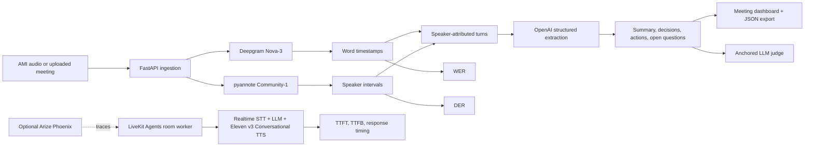

# Converse — conversation intelligence

**Project brief:** turn recorded conversations into a speaker-attributed transcript and an evidence-grounded meeting record, then evaluate transcription, diarization, and summary quality.

## What it does

- Upload WAV, MP3, M4A, MP4, WebM, FLAC, or OGG recordings through the FastAPI app.
- Transcribe with Deepgram Nova-3, retaining word timing and confidence.
- Align transcript turns to pyannote Community-1 speaker segments when its optional local model and Hugging Face access are configured.
- Extract a concise summary, explicit decisions, action items with owners/dates when stated, and open questions with an optional OpenAI model.
- Run an optional LiveKit Agents room worker with Deepgram Nova-3, OpenAI, and Eleven v3 Conversational speech output.
- Measure WER, DER, rubric-scored summary quality, and real-time first-token/first-audio timing.

## Architecture



## Run locally

1. Copy `.env.example` to `.env` and add the provider keys you intend to use.
2. Install the API: `python -m pip install -r requirements.txt`.
3. Install the web dependencies: `npm ci`.
4. Start the API: `uvicorn backend.app:app --reload`.
5. In another terminal, start the dashboard: `npm run dev`.
6. Open the Vite address, choose a meeting recording, and process it.

The API starts without provider keys. Add `DEEPGRAM_API_KEY` to enable transcription. Add `HF_TOKEN` and accept the model terms on Hugging Face for pyannote Community-1 diarization. The default image stays small and omits the model's heavy runtime; build the high-memory batch image with `docker compose --profile diarization up --build app-diarization` (port 8001), or install `requirements-diarization.txt` in a suitable local environment. Add `OPENAI_API_KEY` to create the structured meeting record; without it, the app returns transcript sentences as a minimal summary and leaves decisions/actions empty.

### Privacy and storage

Uploaded audio is sent to Deepgram for transcription and written to a temporary local file for diarization, then the temporary file is removed after processing. If `OPENAI_API_KEY` is configured, the transcript and speaker turns are sent to OpenAI for structured extraction. Audio files are not stored as meeting records. Processed transcript records live in application memory and are lost when the service restarts. Keep secrets in environment variables; never commit `.env` or real meeting recordings.

The app requires HTTP Basic credentials in Render because `REQUIRE_ACCESS_AUTH=true` is set in the Blueprint. This architecture does not use a database; processed meeting records are kept in a capped in-memory list for the demo and disappear after a service restart.

## Batch API

`POST /api/meetings` accepts multipart form data with one `audio` file and returns a structured record:

```json
{
  "title": "Weekly planning",
  "duration_seconds": 1534.2,
  "turns": [{"start": 1.2, "end": 3.8, "speaker": "SPEAKER_00", "text": "Let's review the launch plan."}],
  "summary": ["The team agreed to..."],
  "decisions": [{"decision": "Move the review to Thursday.", "evidence": "Let's move the review to Thursday."}],
  "action_items": [{"task": "Share the draft", "owner": "Maya", "due_date": "Friday", "evidence": "Maya will share it Friday."}],
  "open_questions": []
}
```

Other routes: `GET /health`, `GET /api/meetings`, and `GET /api/meetings/{id}`.

## AMI evaluation

Use the AMI Meeting Corpus as the real-recording benchmark; the dataset is not copied into this public repository. Prepare a JSONL manifest containing human transcript references and system hypotheses. Include RTTM file paths for human/system speaker turns to score DER, and reference/hypothesis meeting records to run the LLM judge.

Install evaluation dependencies with `python -m pip install -r requirements-evaluation.txt`, then run:

```sh
python -m evals.run path/to/ami-manifest.jsonl --judge --output eval-report.json
```

WER and DER are averaged over the manifest rows that contain those annotations. `--judge` uses the fixed 1–5 anchor rubric for factuality, decision coverage, action-item quality, and completeness; it requires `OPENAI_API_KEY`. Keep the AMI audio, annotations, and any derived private material outside Git and follow the dataset's access terms.

## Optional real-time path

The `realtime/agent.py` worker joins a LiveKit room, uses Deepgram for streaming transcription and diarized speaker IDs, handles meeting recap requests with an LLM, and speaks through the ElevenLabs `eleven_v3_conversational` model. Its Docker image is separate from the small batch API image:

```sh
docker compose --profile realtime up --build
```

Set `LIVEKIT_URL`, `LIVEKIT_API_KEY`, `LIVEKIT_API_SECRET`, `DEEPGRAM_API_KEY`, `OPENAI_API_KEY`, `ELEVEN_API_KEY`, and `ELEVENLABS_VOICE_ID`. Room dispatch and client token issuance are managed in LiveKit Cloud. TTS provider timing reports first audio byte; LLM metrics report first token. Set `PHOENIX_COLLECTOR_ENDPOINT` to enable optional Phoenix tracing. Tracing may include prompts and transcript text, so use it only with an appropriately secured collector.

## Deploy on Render

The Blueprint keeps the existing service name so the deployment URL can remain stable. Add `DEEPGRAM_API_KEY`, `HF_TOKEN`, `RELAY_ACCESS_USERNAME`, and `RELAY_ACCESS_PASSWORD` as Render secrets. Add `OPENAI_API_KEY` if you want structured records. The public repository contains the app code only, not keys or AMI data. The optional pyannote package/model is memory-heavy; for small free instances, run diarization locally or deploy a worker with sufficient memory.

## Provider references

- [Deepgram pre-recorded transcription API](https://developers.deepgram.com/reference/speech-to-text/listen-pre-recorded)
- [LiveKit AgentSession](https://docs.livekit.io/agents/logic/sessions/)
- [LiveKit Deepgram STT](https://docs.livekit.io/agents/models/stt/deepgram/)
- [LiveKit ElevenLabs TTS](https://docs.livekit.io/agents/models/tts/elevenlabs/)
- [ElevenLabs v3 Text-to-Dialogue WebSocket](https://elevenlabs.io/docs/eleven-api/guides/how-to/websockets/tts-vs-ttd-websockets)
- [Arize Phoenix tracing](https://arize.com/docs/phoenix/learn/tracing/how-tracing-works)
